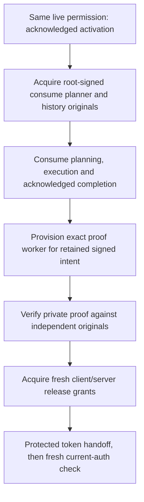

# Request-scoped activation inputs

The private activation continuation is not yet a callable public activation
flow. Its permission belongs to one live request, process, thread and original
work/time allowance. Returning from that context revokes it; a later HTTP call
cannot resume it by supplying a retained result or permission-shaped object.

This guide records the remaining integration boundary. It does not describe a
deployed provisioner or grant authority to create resources.

## Three acquisition points

All three acquisition points need an independently authorized provider and
actual resource delivery. A signature-producing library or a bounded socket
protocol alone does not close any of them.

| Point | Derivable from authenticated request history | Independently provisioned inputs still required |
| --- | --- | --- |
| Consume planning | Exact activation target/authorization, reserve and ACK, signed completion/state receipt, complete after-vector | Root signer, planner/history identities and keys, DB/TLS/state configuration, actual descriptor/listener/directory bindings and quotas |
| Private proof | Signed release intent, exact consume completion and target | Root release custody and proof-worker originals, distinct proof signer, historical/delivery custody, actual resource delivery |
| Release grants | Genuine proof/intent/possession, deterministic outcome, full release request identity | Root issuer policy and signer, independently pinned proof-worker original, client identity/endpoint, authorized release listener and outcome-directory bindings |

Consume history and planner producers already exist in
`oidc_session_activation_history_custody_bootstrap.py` and
`oidc_session_activation_delivery_planner_bootstrap.py`. Their public caller
readmits the resulting original bytes. They neither allocate resources nor
replace the running planner's admitted configuration. The proof worker has its
own original-bound cold construction and one-shot lifecycle.

## Release issuance decision

The [issuer policy](oidc-session-activation-release-grant-issuer-policy.md) pins
the exact independently provisioned proof-worker bootstrap by its framed
identity, together with static client and release-resource bindings. The proof
bootstrap carries root-authenticated completion/receipt expectations; those
expectations must not be copied from the unverified proof being admitted.

The [grant producer](oidc-session-activation-release-grant-production.md) receives
the exact LIVE raw7 request and genuinely admits its originals before composing
the existing storage, server-bootstrap and client-authorization producers.
The old token is required ephemerally: the request identity includes its exact
bytes, so an old-token digest cannot replace it. Neither token nor request
frames belong in a journal, diagnostic log, response status or cached success
object. The public application receives no root signing key.

The [grant transport](oidc-session-activation-release-grant-transport.md) carries
only that fixed request and opaque client/server originals. Policy, proof-worker
bootstrap, resource paths/inodes, signing keys and expected authority graphs do
not enter through its request. An actual service must independently obtain and
authenticate its policy and resource inputs before invoking the producer.

A signed empty checkpoint is an independent authorization expectation, not an
observation that a directory is empty. Likewise, signed device/inode values do
not prove that resources were opened, remain owned, or were delivered to a
worker. Existing release startup must authenticate and observe its exact
resources; issuer deployment and delivery remain necessary.

## Public request and truthful response

The [activation HTTP data contract](oidc-session-activation-http-contract.md)
accepts the retained target digest and separate permission/planning WebAuthn
inputs. It accepts no root grant, proof, actor/session override, token, socket,
resource locator or time allowance in the request body. The actual pending
cookie is still required. Parsing those fields is
not verification of either ceremony and does not register a route.

The future handler must run permission, acquisition, dispatch and protected
handoff inside one context. Input acquisition consumes that same bounded work
and deadline; it cannot replace either after a remote wait. Lost or uncertain
responses do not authorize automatic activation retries.

Only a genuinely known pre-dispatch refusal may report `not-dispatched`.
After dispatch, or if its occurrence is uncertain, report an unknown outcome
and preserve the pending cookie. Even a verified returned token is followed by
the genuine current session/credential/identity check before cookie replacement
and an authenticated-session response. That public route, resource provisioner,
separate recovery authorization and portal integration remain open.
