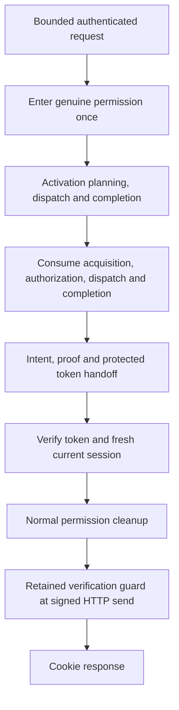

# Public session activation

Source `.201`; unbuilt, unexecuted and unprovisioned. The explicit
`POST /api/auth/session/activation` connects the protected activation sequence
to the actual pending browser request. This is not a recovery endpoint, a
provisioner or proof that a browser received a usable session.

## Request and authority

The [closed request contract](oidc-session-activation-http-contract.md) admits
at most 256 KiB of immutable JSON bytes. It carries a retained-finalization
locator, a fresh action-bound permission assertion and a separate planning
assertion/challenge. It does not accept a posted identity, target, root grant,
private packet, token, deadline or successful-permission object.

The [HTTP adapter](control-plane-oidc-session-activation-routes.md) supplies the
actual Request and bounded original body. The real permission owner authenticates
the pending cookie, cookie-specific CSRF, current actor, retained subject,
sole bound credential, fresh assertion and configured approval. Permission
counter updates precede counter-sensitive planning. Merely having all configured
endpoints is not authorization or a readiness check.

## One request, one live permission

The [orchestrator](control-plane-oidc-session-activation-http.md) opens one
work/clock bracket before native owner operations and keeps the whole private
sequence inside one actual permission context. Existing durable claims and
original admission remain in their genuine continuations. It does not compose
standalone wrappers that revoke permission between operations or recreate a
permission from returned data.

The first possible activation-dispatch call sets an irreversible local boundary.
After that point, failures are conservatively unknown outcomes, even when no
reply or complete result exists. No exception handler repeats an issuer, SQL,
proof, release or cookie operation.

## Final delivery

The [delivery boundary](control-plane-oidc-session-activation-delivery.md) retains
the actual token verifier's full current guard and final narrowed limits.
It then performs fresh authoritative session/identity lookup and matches the
retained user, session and credential before staging the cookie. Token bytes
are never a JSON result or a durable journal entry.

The response may leave the handler only after successful per-call permission
cleanup. A source-owned final check joins the same response to the outer signed
HTTP send boundary; it may not downgrade to an earlier parent timeout or call
a revoked permission. No global enrollment owner is closed. Cleanup, signing
or final-guard uncertainty must not emit a stale success cookie/proof. Failure
before response start can return the fixed unknown-outcome response; a transport
failure after response start cannot be rolled back or converted into evidence
that the cookie was not received.

| Known state in this invocation | Response boundary |
| --- | --- |
| Proven refusal before activation dispatch | Rejected-before-dispatch; no cookie replacement |
| Dispatch attempted or uncertain | Outcome unknown; preserve pending cookie; no automatic retry |
| Genuine token/current-session checks and normal cleanup succeed | Fixed token-free success body; cookie only through final guarded send |

Pre-dispatch refusal says nothing about earlier requests or a permission
assertion's counter side effects. Neither an HTTP status nor a staging ACK
proves independent production currentness or browser receipt.

## Execution decision and remaining work

The async route directly invokes the bounded synchronous core on the ASGI
thread. This deliberately preserves the original permission and final verifier
thread identity without transferring live authority to another thread. It can
block the control-plane event loop for the bounded operation; it is not a
high-concurrency or measured-performance claim. The ordinary Rust proxy hot
path is unchanged. Any later offloading must preserve the complete authority,
cleanup and final-send contract, not disable thread checks or renew allowances.

Independent resources and deployment, separately authorized recovery, portal
controls, final browser confirmation, the remaining workload/provider work and
all production acceptance gates remain separate obligations. Build and runtime
verification follow the complete source freeze.
