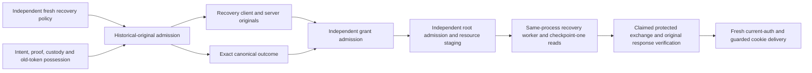

# Public activation recovery: actor and authority boundaries

Recovery is a separate user action, not another activation attempt. The source
contains bounded recovery options, a private live actor context, and separate
original-only recovery-grant production and admission. A dedicated cold private
issuer and finite verified client now connect to independently signed parent
configuration, the live private actor and durable acquisition records. The same
context stages its retained server original through a separate recovery-only
root receiver and same-process worker continuation. A separate private recovery
context now connects the protected exchange and genuine token response
verification while the fresh actor remains live. The bounded public recovery
POST now selects a source-owned terminal before that exchange and joins fresh
current-authentication checks, normal cleanup and the guarded cookie send.
Original-bound completion for failures before retained release intent remains
in progress. Its distinct cold configuration, bounded target reader, historical
target admission and private fresh actor are connected, but not a completion
exchange or public reconciliation action. This does **not** close activation
step 23 or demonstrate a recovered browser session. Source remains unbuilt,
unexecuted and unprovisioned.

## Why the activation permission cannot be reused

Protected activation may replace the pending token before the browser receives
its new cookie. The old cookie then no longer authenticates the current session.
Normal OIDC login also creates a different session and replaces that cookie;
neither behavior proves permission over the original activation target.

The recovery path instead combines three distinct checks:

1. Genuine replay of retained finalization originals and its acknowledgment
   selects the original user, session and sole credential.
2. A root-enrolled historical release-intent signature joins that target to
   possession of the old cookie and the still-live original delivery interval.
   This is narrowly scoped target evidence, not full release authorization.
3. A fresh recovery-specific WebAuthn assertion authenticates that exact key,
   with current credential trust, target-session state, authoritative roles and
   configured independent approval checked under a live context.

The old cookie is never a current-identity lookup or a substitute for the fresh
assertion. No additional token cookie, re-login workflow or plaintext token
journal is introduced. A lost old cookie is not repaired by this path.

```mermaid
flowchart LR
  R[Bounded request and old cookie] --> E[Original target and possession checks]
  E --> O[Fresh recovery options]
  O --> W[New target-key assertion]
  W --> A[Current roles, trust and approval]
  A --> P[Live private actor context]
  P --> I[Independent policy and retained originals]
  I --> D[Durable acquisition claim before issuer contact]
  D --> G[Verified and retained recovery grants]
  G --> S[Independent recovery worker staging]
  S --> X[One claimed protected exchange and verified token]
  X --> C[Fresh current-auth and guarded cookie delivery]
```

## Public options and one bounded recovery action

`POST /api/auth/session/activation/recovery/options` accepts only the closed
[recovery request contract](../serverware/oidc_session_activation_recovery_http_contract.py):
the fixed schema and purpose plus `localDigest`, within 64 KiB. Options reject
MFA fields; `POST /api/auth/session/activation/recovery` may carry a fresh
assertion and approval identifier. Neither carrier accepts a user, session, credential,
clock, grant, proof, outcome or token from JSON.

The actual request must pass exact configured-origin and cookie-CSRF checks.
The options response is a genuine action-bound WebAuthn challenge, not evidence
of an authorized recovery or an active session. The private authorization
context independently repeats original admission before consuming the fresh
assertion. It does not accept a previous options result as permission.

The fresh assertion binds the retained target and exact original-association
and old-token digests. The activation-authorization digest selected from local
claim metadata is only an association locator: including it in the assertion
does not authenticate the old execution or turn that metadata into a grant.

Current RBAC must have an active authoritative binding; no development-role
fallback or unrelated bearer/admin identity selects this flow. When two-person
approval is globally enabled, an uncovered recovery action is a configuration
refusal, not a silent approval bypass. The default action list and requester
role classification explicitly include recovery.

## Narrow, read-only retained-original selection

The source-owned selector uses the journal's existing exact-target consume
index. It reads only the activation claim, consume claim and retained release
intent, with actual bounded metadata-sized charges before file reads and
normal-close identity checks. It does not load the large prepared ciphertext,
proof setup, private packet or entire activation/consume inventory.

Expected absence is unavailable evidence, not corruption and not permission to
resend. Changed identities, malformed records or inconsistent retained metadata
still fail closed. The selected record objects are ordinary original evidence;
the historical inspector replays and verifies the actual authoritative inputs.

Original work, processing bounds and clock floors remain joined through actor
admission and its guarded lifetime. A busy startup owner is refused immediately,
without waiting, retrying or opening a later allowance. Actual startup/trust
locks stay held during the private authorization context; its scope is
invalidated on exit. No old activation permission is reopened and no old intent
interval is renewed.

## Private actor-to-grant acquisition

Explicit [parent/v15 configuration](control-plane-oidc-session-activation-release-recovery-grant-acquisition-bootstrap.md)
adds the fixed recovery issuer endpoint and exact independent policy, historical
custody and proof/intent enrollment originals. Both existing parent intent and
proof configurations are required. Older parent versions and null configuration
leave this lane disabled; the parent byte limit and key/descriptor inventory
are unchanged. Public configuration supplies no private signer or permission.

The private acquisition context enters the actual fresh actor authorization,
then selects only the two retained claims, intent, proof response and small
encrypted completion hints. It does not load prepared ciphertext or treat the
selected metadata as execution authority. The original policy/history, proof,
intent, old-token possession and ciphertext binding are genuinely admitted
under the same actor and processing bounds.

A separate durable acquisition claim precedes issuer contact. Its identity
includes the independently pinned issuer-policy digest and exact retained
target/intent association. An existing or recovered claim cannot resume or
repeat that acquisition, including after a missing reply. An explicitly fresh,
independently root-authorized policy is a different attempt and still requires
fresh actor proof; it is not an automatic retry under the old authority.

The exact client/server/outcome triple is retained **after** genuine original
admission and before the live private continuation is exposed. Framing,
admission, expiry or storage failure can therefore leave a claim without a
retained reply; no malformed-reply retention or rollback is promised. Records
contain public/ciphertext originals and association metadata, never the old
cookie, assertion, request frames or plaintext token. Retained bytes do not
restore actor permission or prove that a private outcome exists.

Before yielding, the acquisition context spends its one-shot staging latch and
relays only its retained server original to the fixed root receiver. The matched
ACK and normal connection close do not establish readiness or token delivery.
The continuation remains context-bound and invalidates on exit. It provides
guarded originals for later exchange, not a transferable permission, public
success endpoint or recovered session. The optional
[public socket mount](../docker-compose.oidc-session-activation-release-recovery-grants.yml)
exposes only preprovisioned issuer and recovery staging sockets, refuses
host-path creation and does not install services or deliver signing keys to the
application.

The separate private `_recover_oidc_session_activation_token` owner facade
enters that actual acquisition context and performs one protected exchange
before yielding. It does not change the acquisition-only facade into an
implicit token request. Its guarded token accessor is available only inside
the live context; neither retaining the Python object nor leaving the context
preserves permission or makes the token safe for a later HTTP send.

## Recovery integration and remaining work

### Fresh recovery grants, distinct from execution authority

The existing LIVE grant issuer authorizes checkpoint-zero release. It cannot be
reused for uncertain-outcome recovery. The separate
[recovery issuer policy](oidc-session-activation-release-recovery-issuer-policy.md)
binds the independently selected historical release, outcome digest, enrolled
signing keys, current client and fixed release resources. Its current interval
does not renew the historical custody, intent, proof or execution intervals;
the original delivery expiry still limits recovery.

The [recovery grant producer](oidc-session-activation-release-recovery-grant-production.md)
accepts the seven original recovery inputs without a candidate outcome. It
authenticates the historical evidence and old-token possession, reconstructs the
outcome, and checks its independently pinned digest before forming the complete
eight-part private recovery request. It emits only a recovery-profile client
authorization, matching server bootstrap and canonical outcome original.
Storage authorization requires checkpoint one and
the independently pinned outcome. Recovery authorization is a separate signed
purpose. Neither a caller-supplied successful object nor an unverified local
association can supply those expectations.

The [independent admission path](oidc-session-activation-release-recovery-grant-admission.md)
re-admits those originals against the separate policy and exact evidence. It
does not trust the producer's return type as proof. Restrictive continuity
callbacks preserve the original work allowance and observed clock floors
through nested verification and signing; they cannot add authority or create
a new processing window. These callbacks are ancestor-only bookkeeping, not
recursive calls into guards that depend on the admission in progress.

Reconstructing an outcome proves its exact contents, **not that the outcome was
durably stored**. The actual private recovery worker must independently read
the unchanged checkpoint-one record before and after guarded token opening.
An absent or changed record must fail; no append, SQL replay, new token or
automatic retry repairs it.

### Service, storage and public completion

The separate [cold recovery issuer](oidc-session-activation-release-recovery-issuer-service.md)
uses role `oidc-session-activation-release-recovery-issuer`, UID/GID 65493, and
the fixed private `recovery-grants.sock` listener. Its
[root resource intake](oidc-session-activation-release-recovery-issuer-delivery.md)
admits the actual signed launch and all four independent policy/history
originals before opening the independently pinned signer. The eight inherited
descriptors carry only the root public key, signed bootstrap, listener, policy,
historical release custody, proof enrollment, intent enrollment and root
signing key. There is no AES key, outcome directory or SQL/state writer.

The original construction ledger, opening and narrowed deadlines survive the
permanent privilege drop in the same process. One accepted request contains
the issuer purpose plus recovery prefix7; only the exact three-original
response is returned. The private client admits independent policy before
contact and genuinely verifies the returned originals. Neither a successful
socket exchange nor a signed response establishes actor permission, a stored
outcome, release-worker readiness or token delivery. There is no automatic
retry or replacement processing allowance.

The [service template](../ops/systemd/serverware-oidc-session-activation-release-recovery-issuer.service.in)
and [socket unit](../ops/systemd/serverware-oidc-session-activation-release-recovery-issuer.socket)
are unrendered/uninstalled source. They require an independently supplied
immutable runtime root, exact public trust files, private signer and signed
resource identities. The image recipe includes the isolated launcher and these
templates; it does not provision them or turn this trusted-host-local process
into a measured enclave/HSM boundary. No production credentials or account
resources are created by this source integration.

The separate [recovery-only receiver](oidc-session-activation-release-recovery-dynamic-delivery.md)
admits provisioned policy/custody/enrollment originals before accepting the
candidate. It binds the exact existing slot, delivery key and signed listener
identities, stages FDs 198–202, closes staging normally, and continues through
the permanent UID/GID 65502 drop into the existing runner. Its optional units
exclude the static and LIVE listener owners and mount outcomes read-only.
The [continuity chain](oidc-session-activation-release-recovery-continuity.md)
retains original work and ancestor guards through resources, startup, recovery
and native checkpoint-one reads. Outcome body allocation is capped at 64 KiB.
No outcome is created or appended by staging; ACK precedes actual store recovery
and cannot prove that the retained record exists or that serving succeeded.

The [private exchange coordinator](control-plane-oidc-session-activation-recovery-exchange.md)
reconstructs its request inside the actual live actor context from the selected
intent/proof/hints, independently configured enrollments and old-token
possession. Genuine historical derivation reconstructs the exact outcome and
raw8 identity; independent policy supplies the expected client scope. Actual
client/server admission precedes the existing token-free durable release claim
and one RECOVERY exchange. The real worker's unchanged-outcome path and the
genuine response verifier are used; a staged ACK or prior admission result is
not substituted for either.

Only a normally closed exchange followed by original response admission can
make the exact token available inside that live context. The receiving guard
retains the original actor, work, clocks and admitted evidence; its ancestors
exclude their own response child. All held representations reduce the same
capacity before processing. No token/request frame is journaled, no outcome is
appended, and no activation or consume SQL is repeated. A failed or uncertain
exchange cannot resume under the same client authorization.

This slice requires a retained release intent. Failures before that stage still
need a distinct original-bound completion/recovery path; they are not treated
as safe activation retries. Full recovery still needs that original-bound
completion path and evidence that the protected path works at runtime. The
source-connected public exchange does not complete those remaining steps or
demonstrate actual private-store behavior.
The existing LIVE staging path is not reused
as recovery admission. A once-checked actor, retained triple or intent result
cannot replace any of these checks.

The earlier historical target now uses a
[combined preallocation-checked reader](control-plane-registration-finalization-completion-history.md).
Fixed association indexes select at most fifteen files; actual identity/size
metadata and the caller's remaining representation allowance are checked before
the first body read. Each body is read once, preserving original linkage and
corruption checks. The caller reserves held request/token/configuration inputs,
cold-parent/enrollment representations and replay headroom first. Later
acquisition separately reserves its held actor result and new inputs on the same
cumulative work. The earlier post-load accounting gap is source-connected;
this is not a whole-process 64 MiB heap guarantee or execution evidence.

## Earlier-stage completion prerequisites

Missing release intent cannot be repaired by inventing an intent-stage target
or reopening the old live permission. A separate
[completion-recovery parent configuration](control-plane-oidc-session-activation-completion-recovery-bootstrap.md)
selects fixed activation/consume roles, independent authorization/packet/pending
pins and existing completion-only endpoints. Parent v16 enables these explicit
nullable roles; older versions and null leave them disabled. The public app
receives no private history/AES custody or additional descriptors.

The [bounded exact-target selector](control-plane-oidc-session-activation-completion-recovery-selection.md)
reads only the dispatch claim and prepared raw5 after reserving actual encoded
sizes. The [historical inspector](control-plane-oidc-session-activation-completion-recovery-history.md)
genuinely authenticates caller/planner originals, independently reconstructs
static expectations and joins the finalization target/ACK and old-cookie
possession. Signed typed arguments supply the old/new commitments and credential
record; they do not supply a fabricated delivery identity, timestamp or intent.

The [distinct private actor](control-plane-oidc-session-activation-completion-recovery-actor.md)
requires current target, sole credential, roles and trust, a fresh assertion
bound to the independently configured completion profile, and required approval.
It keeps the same owner/work/clock bounds and startup/trust locks. Sharing the
existing current-auth checks does not let an exact intent-stage acquisition
accept this different actor type or turn its output into token permission.

These are connected source prerequisites, not a recovered completion. Historical
public-control admission, an irreversible completion-only attempt, the actual
service exchange, genuine response admission and separate durable reconciliation
still need to be connected before the earlier-stage public action is available.
Original uncertainty must remain immutable. No SQL, completion-service call,
token release, cookie replacement or automatic retry follows from this private
actor foundation. COMPLETE remains partial; all enclosing counts are unchanged.

## Final current-authentication and cookie boundary

The [public HTTP core](control-plane-oidc-session-activation-recovery-http.md)
opens one work/window before parsing and enters the same genuine acquisition
context. It chooses the [source-owned delivery terminal](control-plane-oidc-session-activation-recovery-delivery.md)
before exchange derivation and genuine response verification. The terminal
holds original ancestors, exact target and current-authentication snapshots;
it does not turn a returned token or prior successful object into authority.

The recovered token must identify the exact active target session, OIDC user
and bound credential with unchanged authoritative roles, credential trust and
session/provider expiry. Only then is one bounded secure cookie staged with a
fixed non-secret success body. The active context still clears its token and
guard on exit. Explicit markers prove the complete normal cleanup, including
the original trust/startup lock exits; a finally-closed context is insufficient.

After cleanup the terminal repeats genuine receiving/current-authentication
checks and guards the actual `http.response.start` after outer response
signing. Changed state, body, cookie, deadline, downstream response or abnormal
cleanup discards success and emits only a fixed no-cookie uncertainty response
when nothing has yet been sent. It does not renew an allowance to sign a new
success or retry the protected exchange.

No protected activation or consume SQL is repeated here. WebAuthn challenge
issuance and assertion-counter updates remain their normal authentication
effects. Missing, partial or uncertain evidence preserves the existing cookie
and never grants automatic retry. Portal integration, provisioning and all
production acceptance gates remain separate work.
