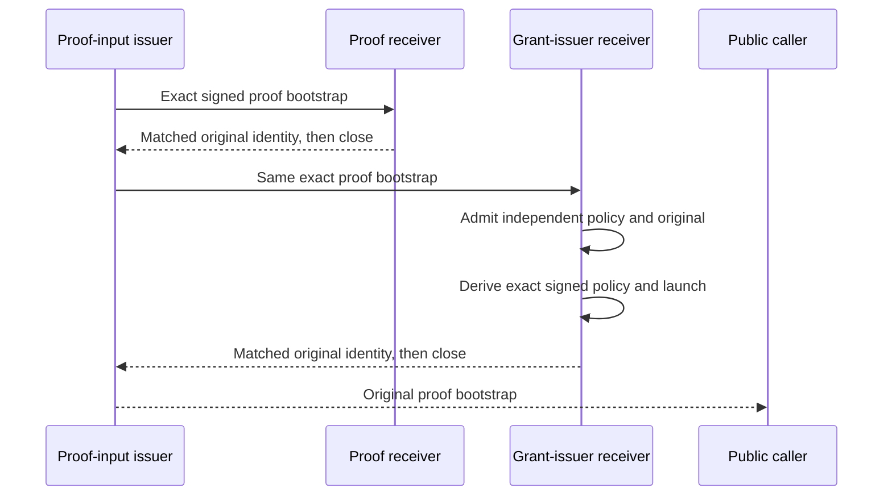

# Fresh proof input for the grant issuer

Source `.200`; unbuilt, unexecuted and unprovisioned. This is a separate input
channel, not the grant issuer's later token-release worker staging channel.
The public application does not acquire the runtime root signer or private
consume packet.

## One original, two bounded deliveries

Explicit proof-input issuer launch `/v2` requires both destinations. Existing
launch `/v1` remains worker-only and retains its exact closed fields. Both
exchanges retain the original work ledger, clock samples and bounded deadline;
accepting a connection or starting the second stage never renews them.
An uncertain first or second delivery is terminal. A staged ACK is not a grant,
proof completion, worker readiness, token delivery or current-session evidence.

## Fixed wire and ownership

`authority_oidc_session_activation_release_grant_input_delivery_transport.py`
fixes the listener to
`/run/catchplate/oidc-session-activation-token-release/grant-issuer-bootstrap.sock`.
Its path owner is root:65494, mode `0660`; the accepted issuer peer is
65494:65494 and the connect-side expected root peer is 0:0.

The distinct request magic is `SWOGIQ01`. The raw2 request contains the fixed
purpose `stage-oidc-session-activation-release-grant-inputs` and the exact signed
proof bootstrap. The response magic is `SWOGIR01`, followed by exactly
`(staged, bootstrapIdentityASCII71)`. Both headers are 24 bytes. The identity
frames the original with
`catchplate.oidcSessionActivationReleaseGrantInputDeliveryBootstrapIdentity/v1`;
it is not the proof worker's differently domain-separated staging identity.

The bootstrap ceiling is 48 MiB and the whole exchange ceiling is 64 MiB.
The receiver's remaining retained-original capacity can only tighten the body
limit before allocation. Magic, exact lengths, fixed peers, immutable raw2 and
EOF are mandatory. The sender matches the returned identity to its exact
outgoing bytes and requires a normal owned-channel close before returning.

Only the actual proof-input issuer's private `_GrantDeliveryChannel` may open
the outgoing connection. It owns one fixed socket slot and authenticates the
original owner, work, endpoint and current guard. Neither this codec nor a
caller may supply a replacement socket, arbitrary descriptor exemption or
successful authority object.

## Independent receiving and optional packaging

The [separate root receiver](oidc-session-activation-release-grant-issuer-dynamic-delivery.md)
holds six protected public trust originals: runtime root,
[dynamic authorization](oidc-session-activation-release-grant-issuer-dynamic-authorization.md), proof-input issuer policy, completion bootstrap,
proof enrollment and intent enrollment. Admission of the fresh proof original
precedes root-signer access. It then derives and genuinely verifies the existing
exact issuer-policy and issuer-bootstrap originals, seals the original files
into the existing six-FD inventory and continues the grant service after permanent same-PID
drop to UID/GID 65496. Existing static policy and launch checks are not relaxed.

The opt-in `release-grant-issuer-bootstrap.socket`, alternate
`release-grant-issuer-dynamic.socket` and `release-grant-issuer-dynamic.service.in`
templates use the `catchplate-oidc-session-activation-` prefix. The latter two
replace, not accompany, the static grant issuer. The service binds only the
dynamic public trust directory and its separately protected runtime signer;
it receives no TLS, AES/history keys, SQL writer or completion signer.

`release-proof-input-issuer.service.d/grant-intake-v2.conf` is an opt-in socket
dependency companion for the two-destination launch. Copying it does not change
the signed profile. Templates and launchers are copied into the immutable image
recipe without rendering, installing or starting them. Independent resource
provisioning, public HTTP/current-auth/cookie completion, recovery, portal work
and full production acceptance remain separate obligations.
