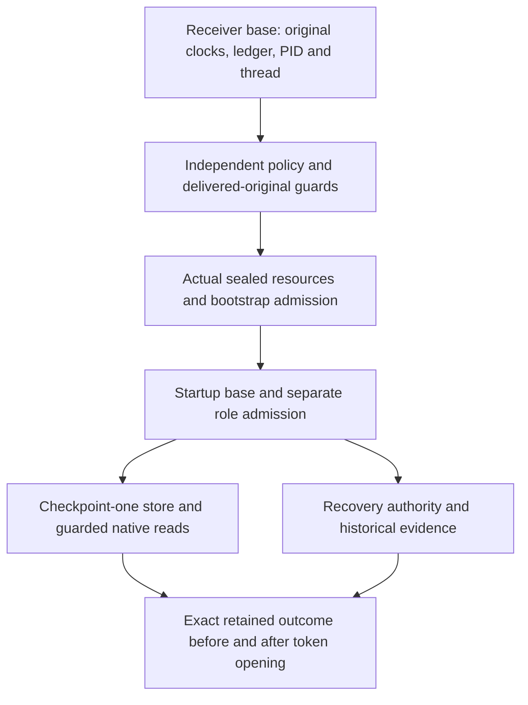

# Recovery worker continuation and retained outcome reads

The recovery-only dynamic receiver carries one original construction ledger,
clock opening and narrowed deadline through resource staging, permanent
privilege drop and the existing release worker. The public actor has its own
original request allowance; neither process serializes a successful permission
object or accepts another process's clock as authority. This is source-only
integration, not deployment, enclave isolation or runtime evidence.

## Guard direction

Each verifier receives only guards for already admitted ancestors. Its returned
guard may then be included in an outer continuation, but never in its own
ancestor. In particular, startup separates its resource-only `base_current`
from its aggregate role guard. The store's guards do not read the store, and
the recovery evidence guards do not invoke the later joined evidence guard.

The receiver's upstream guard survives the UID/GID transition and never calls
downstream resource, startup or journal operations. Resource intake passes that
guard into nested bootstrap admission and its bounded sealed-original reads.
Startup's own role admission calls only the resource base, while store and
recovery construction retain the already admitted startup continuation.
Historical custody, intent and proof admission retain their upstream guard.
The existing authenticated token opening remains between exact store readbacks.

## Capacity before inherited reads

The receiver supplies a strictly additive held-representation count to
`_intake_from_delivery_on_work`. Before inherited body reads, actual sealed
metadata must fit this reservation in the same 64 MiB capacity:

`held + 16 * bootstrapBytes + 8 * rootBytes + 8 * recoveryOperationBytes`

The server-bootstrap footprints reserve receiver/resource/startup originals and
nested captures. The fixed operation inventory is the existing proof, intent,
both enrollments, outcome, ciphertext, old token and raw key maxima. A positive
receiver reservation activates this additional check; zero preserves the older
static caller contract. It cannot raise the capacity or create new validation
work. The actual resource configuration retains the calculated reservation.
These are conservative byte-representation bounds, not a Python heap/RSS bound;
otherwise individually valid large inputs may be refused.

## Native read boundary

The private outcome store carries the original ancestor into grant re-admission,
journal construction and native recovery/readback. The native reader checks the
actual stat size against the outcome codec's 64 KiB cap before allocation,
uses a fixed-size buffer, meters read/copy/hash work first, and brackets reads,
hashing, synchronization and identity checks with the same guard. Descriptor
cleanup runs even when the guard fails; normal close is followed by another
guard check. Guarded native reads run directly because their ancestor may charge
the same work; wrapping them in a metrics-stable callback would reject those
legitimate charges.

The existing journal's default APIs remain available to other callers. These
new optional hooks only tighten selected reads; they do not grant filesystem
access or create paths. Recovery still requires the independently pinned exact
checkpoint-one record. Its two `retain_on_work` calls are readbacks of that
existing record, never the empty-slot publication branch. An absent, changed,
oversized or uncertain record fails closed, without creating another outcome
or repeating activation SQL.

Worker staging acknowledgment binds only the exact staged server original.
It is not evidence of successful worker startup, store existence, recovered
token or browser session. Public protected exchange and cookie completion,
prior-stage recovery, portal work and independent production acceptance remain
separate requirements.
