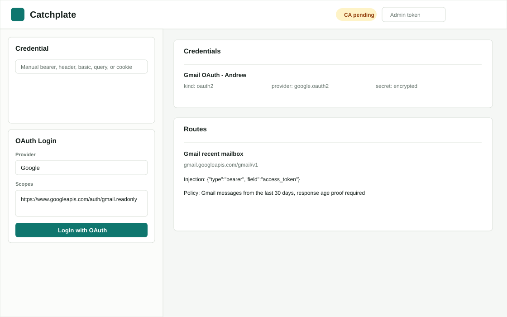
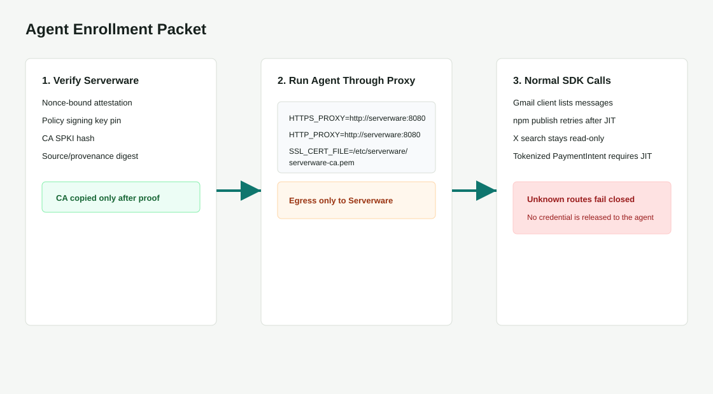

# Portal OAuth And Agent Guide

This guide covers the operator path for connecting OAuth-backed services in the Serverware portal and the agent path for using those credentials without ever receiving them.



## Configure OAuth Providers

Serverware currently has first-class portal OAuth setup for Google and X/Twitter.

Google:

```bash
export SERVERWARE_PUBLIC_URL=https://serverware.example.com
export SERVERWARE_GOOGLE_OAUTH_CLIENT_ID=...
export SERVERWARE_GOOGLE_OAUTH_CLIENT_SECRET=...
export SERVERWARE_GOOGLE_OAUTH_REDIRECT_URI=https://serverware.example.com/api/oauth/callback/google
```

X/Twitter:

```bash
export SERVERWARE_PUBLIC_URL=https://serverware.example.com
export SERVERWARE_X_OAUTH_CLIENT_ID=...
export SERVERWARE_X_OAUTH_CLIENT_SECRET=...
export SERVERWARE_X_OAUTH_REDIRECT_URI=https://serverware.example.com/api/oauth/callback/x
```

The portal uses OAuth 2.0 Authorization Code with PKCE. The start endpoint requires an authenticated Serverware operator and, when production controls are enabled, the same WebAuthn and two-person approval gates as normal credential creation. OAuth state is server-side, one-use, TTL-bound, and size-bounded before it is written to disk. The callback consumes the state value, exchanges the code, encrypts the token response as a credential, publishes a versioned lease, and audits the provider, scopes, credential version, and approval evidence without logging token material.

## Login In The Portal

1. Open `http://localhost:3000` for local Docker or the production control-plane URL.
2. Enter an admin token or use the production OIDC login path.
3. In **OAuth Login**, choose `Google` or `X / Twitter`.
4. Keep the default scopes for common read-only use or enter stricter provider scopes.
5. Click **Login with OAuth** and finish the provider consent screen.
6. After callback, the credential appears as `kind: oauth2`.

OAuth credentials store token material as encrypted JSON. Policies should inject only the access token:

```json
{"type": "bearer", "header": "Authorization", "field": "access_token"}
```

`field` must be a strict dotted object path. If that field is missing, empty, not a string, uses wildcard syntax, or the secret is not JSON, Serverware fails closed before forwarding the request.

## Assign The Credential

Production policy should be published as a signed `PolicyBundle`, not as ad hoc route state. The portal route templates are a local authoring aid; the enforced production contract is the signed bundle.

Minimal Gmail example:

```json
{
  "id": "gmail.last_30_days",
  "principals": ["agent:mail-reader"],
  "match": {
    "scheme": "https",
    "host": "gmail.googleapis.com",
    "port": 443,
    "methods": ["GET"],
    "paths": ["/gmail/v1/users/{user}/messages", "/gmail/v1/users/{user}/messages/{message_id}"]
  },
  "credentialRef": "google-oauth:andrew",
  "adapter": {
    "type": "gmail.v1",
    "config": {
      "maxAgeDays": 30,
      "maxResults": 10,
      "forceQuery": true,
      "allowMessageGetOnlyFromPriorSearch": true,
      "denyEquivalentEndpoints": ["threads", "history", "attachments", "imap"],
      "response": {
        "validateInternalDate": true,
        "validateListByMetadataFetch": true,
        "allowedFields": ["id", "threadId", "labelIds", "snippet", "internalDate", "payload.headers"]
      }
    }
  },
  "constraints": [
    {
      "id": "gmail-response-age-proof",
      "type": "responseDateWindow",
      "phase": "response",
      "items": ["messages"],
      "dateFields": ["internalDate"],
      "formats": ["epochMillis"],
      "maxAgeDays": 30,
      "required": false
    }
  ]
}
```

Common examples live in [credential-limits.examples.json](../policies/credential-limits.examples.json):

- Gmail only from the last 30 days, validated again on response.
- X recent search read-only with seven-day lookback and response age validation.
- X posting limited to one post per day.
- npm publish/dist-tag writes requiring one-use WebAuthn JIT approval.
- Slack posting with hourly quotas and body allowlists.
- GitHub issue reads limited by `since` and response timestamps.
- Stripe read-only customer access.
- Tokenized checkout creation with amount caps, no raw card fields, daily quota, and hardware-backed JIT approval.
- Object-store writes bounded by path, size, and rate.

## Teach Agents To Use Serverware

Agents do not need provider tokens, OAuth refresh tokens, npm tokens, or API keys. Give them only the proxy/CA setup and the upstream API task.



Generate an enrollment packet:

```bash
python3 scripts/generate_agent_enrollment.py \
  --principal-id agent:mail-reader \
  --proxy-url http://serverware-proxy.internal:8080 \
  --proxy-egress-cidr 10.42.0.10/32 \
  --selector app=mail-reader
```

Install the CA through the verifier:

```bash
export SERVERWARE_ADMIN_TOKEN=...
make install-ca
```

Run the agent with only proxy configuration:

```bash
export HTTPS_PROXY=http://serverware-proxy.internal:8080
export HTTP_PROXY=http://serverware-proxy.internal:8080
export SSL_CERT_FILE=/etc/serverware/serverware-ca.pem
export REQUESTS_CA_BUNDLE=/etc/serverware/serverware-ca.pem
```

Agent instruction block:

```text
Use the normal provider SDKs and upstream URLs.
Do not ask for, store, print, or cache provider credentials.
All HTTP and HTTPS traffic must use the configured Serverware proxy.
If Serverware returns 428, wait for human approval and retry the same request.
If Serverware returns 403 or 5xx, stop and report the route/error; do not bypass the proxy.
```

Enforce egress so the agent cannot bypass Serverware. The enrollment packet includes a Kubernetes `NetworkPolicy` and iptables rules that only allow outbound traffic to the configured Serverware proxy CIDRs.

## Attestation Checks

Before installing the CA or enabling production credentials, verify:

```bash
python3 scripts/verify_codebase_attestation.py \
  --base https://serverware.example.com \
  --admin-token "$SERVERWARE_ADMIN_TOKEN"
```

The verifier checks the quote, runtime manifest, policy signature, source tree digest, release provenance, image signature digest, CA SPKI, and a nonce-bound response signature from the server it contacted. Production completion still requires `make production-release-proof` on the real Linux/Nitro/AppArmor/KMS/Sigstore/registry environment.
