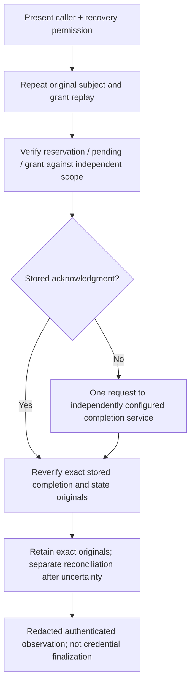

# Authorized historical registration-completion recovery

The separate [public recovery actions](public-registration-recovery.md) connect
the actual cold owner and retained originals to genuine historical verification
and the independently configured completion service. This is **source-only,
unbuilt and unexecuted**, not production acceptance or credential finalization.

## Scope and authorization

[`inspect_retained_registration_recovery_subject`](../catchplate/control_plane_registration_recovery_subject.py)
loads the actual immutable signer/grant association. Genuine
[historical signer replay](registration-signer-history.md) verifies the original
ceremony and evidence, then reconstructs its user/challenge/session/mode and
request identity. Independent [historical exchange replay](registration-history-exchange.md)
verifies planning, caller and grant originals, including the complete before/after
vectors and every original plan commitment. Their actual request and operation
identities must match; mere journal association is not ownership.

The public handler compares this subject with the freshly authenticated operator
or pending OIDC session. A separate recovery action requires fresh, action-bound
WebAuthn and configured two-person approval when credential history exists, or
the configured bootstrap token in the empty-history branch. Current session,
roles, CSRF and credential history remain enforced. An old registration or
execution permission never authorizes the new recovery action.

[`recover_retained_registration_completion`](../catchplate/control_plane_registration_recovery.py)
accepts only a local selector and independently authenticated user/session
scalars, not a successful subject object. Under the actual cold owner's lock it
repeats genuine historical subject replay and the exact caller join before any
transport or storage mutation.

## One explicit recovery flow

The retained reservation and irreversible local SQL dispatch claim are required.
Their presence is not proof of SQL commitment. Before sending, actual historical
pending admission binds original plan/grant/reserve signatures and full scope to
independently configured pending sequence/head/fence. The completion packet
selector comes only from cold-admitted configuration, never an unsigned SQL
response or a returned acknowledgment.

If an acknowledgment already exists, its exact originals are reverified without
a socket request. Otherwise the facade makes one explicitly authorized request
to the separate completion service. That service independently verifies its
fixed historical packet and observes committed evidence through its protected
reader before completing or retrieving the original state acknowledgment.
The facade genuinely verifies the full returned original exchange and signatures
before any authenticated success or durable acknowledgment association.

No branch invokes the SQL executor, creates/releases an execution attempt,
re-signs an execution grant, extends its expiry, or automatically retries. A
missing, late, uncertain or invalid completion response can follow a remote
effect. Failure is reported as unknown, not rollback or nonexecution. A later
explicit recovery request must obtain fresh present-purpose admission again.

## Immutable reconciliation

The existing `completion-outcome` remains the first exact raw4 record. When it
already holds uncertainty, a later verified acknowledgment is stored in the
separate `completion-reconciled` slot. The old uncertain record and SQL claim
remain untouched. The new slot accepts only acknowledged raw4 shape, requires
the original uncertain completion and SQL claim, and permits only identical
idempotent append. Conflicting originals poison the journal instead of replacing
either record. Readback and startup recovery enforce these structural relations.

The binary outcome profile appends kind index 4; all existing indices, magic,
domain and exact earlier encodings stay unchanged. A fixed filename per
preparation bounds reconciliation to one record. The journal's physical scan
ceiling is seven times its existing maximum-record count; byte quota, locked
publication, fsync and file-identity checks remain in force. Older software
rejects the new record kind and cannot safely read a journal containing it.
Do not downgrade a populated journal to an older reader or erase reconciliation
to make downgrade work.

Storage authenticates no signature or remote outcome. Only the actual recovery
composition verifies originals before append, and every subsequent public
success repeats genuine verification. Host-local journal integrity is not
off-host rollback resistance.

## Time, configuration and remaining work

The caller opens one current processing window from its actual independently
admitted owner attestation and fixed endpoint limits. All historical replay,
transport and retention share that unchanged window and cumulative work. Nested
owner checks can only narrow deadlines. Original issue times are not processing
clocks; past expiry is accepted only as historical data and cannot revive SQL
authority. Local checks are not a hard watchdog or independent trusted time.

This version requires the same independently configured historical source,
generation, keys and cohort, plus a currently admitted cold owner. It cannot
discover authority across rotations or treat newer configuration as proof for
older records. Cross-generation historical authority resolution remains separate
work. Root-signed pending scope is not an off-host current-head witness.

Success exposes no originals, packet IDs, credential secrets or replacement
authority. It reports an authenticated completion observation with
`registrationCompleted`, `currentnessEstablished` and `automaticRetryAllowed`
all false. Credential finalization, complete portal recovery UX, independently
provisioned services and full production verification remain open.

Deferred consolidated verification must exercise genuine expired exchanges,
subject/session substitution, changed associations and config/key generations,
fresh permission and two-person branches, independent packet/pending joins,
lost responses, retained acknowledgment reuse without transport, uncertain-to-
reconciled storage without overwrite, conflicting append/restart/quota behavior,
clock/work exhaustion and unchanged live SQL expiry/one-attempt rejection. No
tests, imports, parser execution, builds or runtime checks ran in this batch.
