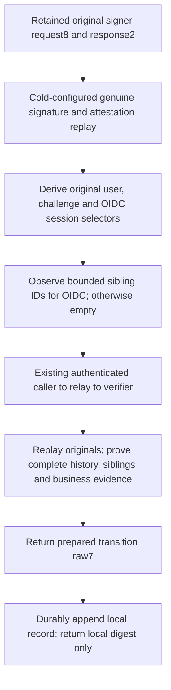

# Registration finalization preparation

Source `.141` connects the existing genuine finalization planner to the admitted
control-plane caller. This is unbuilt, unexecuted source integration, not a
working registration endpoint or production authentication claim.

## Preserve the original evidence

The private
[`prepare_registration_finalization`](../serverware/control_plane_registration_preparation.py)
accepts the retained signer request's eight original byte strings and its two
original response byte strings. It does **not** call the signer again. A new
signature would create a different evidence identity from the one admitted into
the business evidence table.

The authenticated application must own that original exchange and separately
complete its evidence business admission before invoking this continuation.
Local raw6 custody is not that admission. No HTTP handler is changed to claim
registration success, and no new generic caller-provided configuration, key,
time, endpoint, work budget or derived credential is accepted.

## Sibling lookup is not proof

The fixed database observer uses the actual database UTC clock. It selects
same-user, unused, unexpired registration challenges except the chosen challenge,
with no session or approval filter. It reads at most 33 IDs, rejects a population
over 32, validates each ID and returns sorted unique IDs. It neither locks nor
mutates challenges.

The caller derives these selectors only after genuine replay against the
existing cold-admitted enrollment configuration. Its temporary empty-hint request
is used only to obtain the selectors; it never goes to a planner or writer.
The separate verifier reconstructs the finalization request from the originals
and observed hints. Actual complete-query proof and the registration kernel
must establish the exact sibling population at their own cutoff. A concurrent
challenge change can therefore deny preparation; it cannot silently truncate
the population or authorize a retry. Non-OIDC registration sends empty hints.

## Fixed private transport and durability

[`authority_webauthn_registration_finalization_caller`](../serverware/authority_webauthn_registration_finalization_caller.py)
uses distinct `SWRFPQ01` / `SWRFPR01` framing over the existing configured
control-plane → runtime relay → verifier peer topology. The request carries
unchanged signer raw10 plus canonical sibling-list bytes; the response carries
the genuine seven transition-preparation originals. Individual lengths and the
existing total 64 MiB bound are checked before body allocation. The sibling list
has its own 1 MiB transport ceiling and at most 32 bounded IDs.

Peers are admitted before bodies; EOF, configuration, generation, original
attestation receipt and absolute deadline checks remain mandatory. The relay
does not interpret the originals. After complete intake the verifier uses one
work allowance and calls its actual existing finalization preparation method,
which owns its live window. It does not open a second wrapper window.

The caller's one work allowance and original window cover local replay, selector
read and the exchange. Returned raw7 is opaque until downstream authentication;
the existing journal durably retains it before the helper returns a local digest.
A late append retains bytes, not renewed authority. This helper never forwards
to a writer, signs replacement evidence, executes SQL mutations, consumes a
challenge, activates a session or automatically retries.

## Still required

The caller still needs retained original-exchange ownership, actual unconsumed
v2 business evidence, independent current-root/execution authorization and the
separate durable execution/completion path. The private helper does not supply
cross-restart custody for signer raw10, a public finalization endpoint or a
replacement ceremony after expiry. The existing public `/prepare` endpoints
continue to prepare evidence custody only; `/verify` remains on its existing
legacy path. Independently operated production services, exact frozen builds
and consolidated runtime verification remain outstanding.
