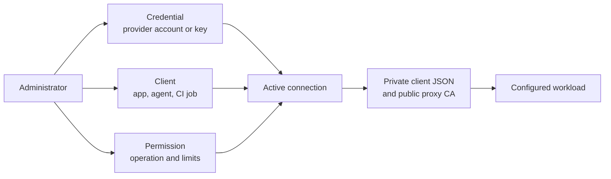
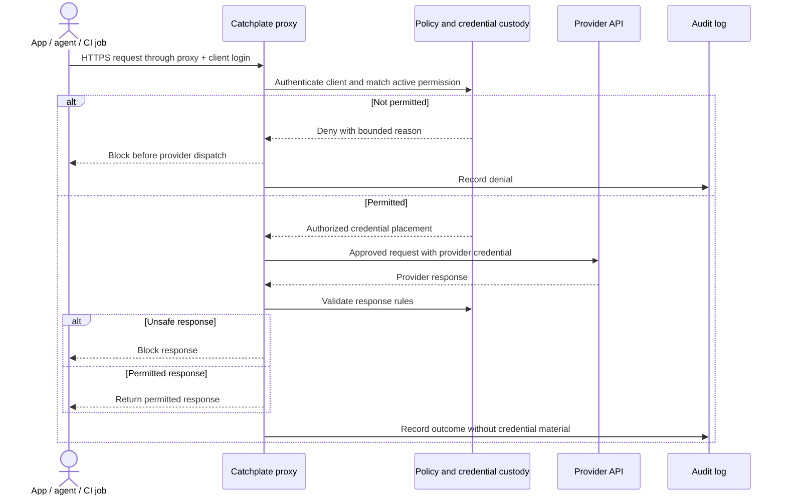
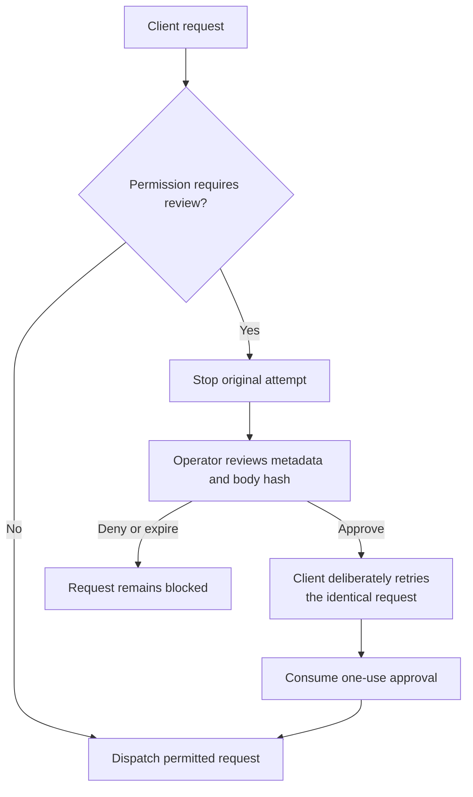
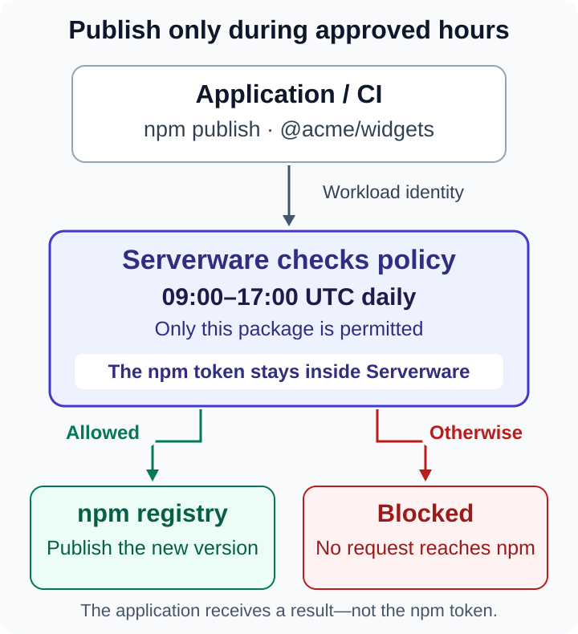

> Publication note: deployment-specific addresses, identities and paths in this document are example placeholders, not a public service or release-verification evidence.

# How Catchplate works

[Home](Home.md) · [Getting started](Getting-started.md) · [Permissions and policies](Permissions-and-policies.md) · [Proxy and CA](Proxy-and-CA.md)

Catchplate separates the credential an API trusts from the identity a workload
uses. The workload receives a scoped Catchplate client token and the proxy's
public CA. The provider credential remains in Catchplate's custody.

## One setup connects three things

An administrator saves a provider credential, identifies the client workload,
and activates a permission joining the two. None of those records alone grants
working access.

The private client JSON contains the Catchplate login and exact connection
recipe. It does not contain the provider key. The CA lets the client verify the
destination TLS connection intercepted by the proxy; it does not grant access.

## Every request is checked before credentials are attached

A response can be blocked after provider dispatch, so blocking a response does
not undo a provider-side write. Clients must not automatically retry uncertain
writes. Request and response restrictions depend on the selected operation;
Catchplate is not an unrestricted tunnel to every endpoint at a provider.

## Approval stops the original attempt

Ordinary approval is host-trusted. It helps an operator control sensitive
actions, but someone with full control of the server can bypass it. Future TEE
enforcement is a separate trust model.

## A concrete scoped-write example

The existing npm diagram shows the same boundary for a named package and time
window. It is an illustration of policy evaluation and credential replacement,
not a preconnected npm account.

## Where each piece belongs

| Piece | Held by | Purpose |
| --- | --- | --- |
| Provider credential | Catchplate | Authenticates the approved request to the provider |
| Catchplate client token | Workload | Identifies one app, agent or CI job to the proxy |
| Permission | Catchplate policy | Joins a client to a credential for exact operations and limits |
| Public CA | Workload trust configuration | Verifies intercepted destination TLS without disabling verification |
| Audit record | Catchplate | Records the decision and outcome without storing credential material |

Continue with [Getting started](Getting-started.md) to configure the first
connection, or [Clients and recipes](Clients-and-recipes.md) if you already have
the private client JSON and CA.
