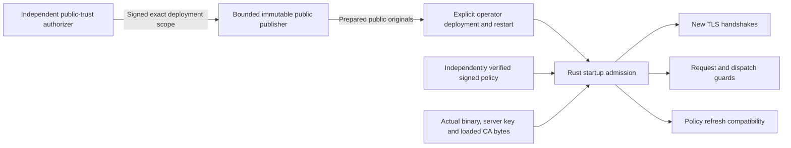

# Authorized workload ingress trust

This source connects independently authorized public trust publication to the
standard Rust ingress's actual loaded CA bundle. It is unbuilt, unexecuted and
unprovisioned. It does not establish a tested deployment, native trust rotation,
hardware custody or production acceptance. N04 remains partial.

## Separate authorities

The workload CA signs client certificates. The issuance-grant signer authorizes
particular issuance requests. A separate public-trust authorizer permits this
exact ingress configuration to trust the CA. Neither a certificate response,
CSR, enrollment packet nor CA-install capability authorizes trust publication.
No CA private key enters this publication or startup verifier.

The trust authorizer's public key and its pin must be supplied independently by
the operator's trusted configuration. A key copied from the authorization record
or an untrusted publication manifest cannot select its own trust root. Runtime
admission also excludes the actual CA and policy-signing keys from this role.
This is an explicit trusted-host-local profile, not hostile-host isolation.

## Initial immutable profile

`immutable-single-issuer-startup-v1` admits exactly one canonical PEM CA original.
The bundle and separately pinned issuer original must be byte-identical. There
is no implicit old/new issuer overlap or extra unlisted root. Issuer certificate
DER and DER SubjectPublicKeyInfo commitments are distinct from the hash of exact
PEM bundle bytes, and all are checked.

The CA uses the existing restricted issuer profile: critical CA BasicConstraints
and key-cert-signing KeyUsage, with only BasicConstraints, KeyUsage,
ExtendedKeyUsage, AuthorityKeyIdentifier and SubjectKeyIdentifier extensions.
If ExtendedKeyUsage is present, it must allow client authentication. Supported
public keys are Ed25519, P-256, P-384 and RSA from 3072 through 4096 bits.
Self-issuance is not required: independent authorization selects the exact trust
anchor, rather than treating a self-signature as authorization.

The initial text/selector representation is bounded canonical ASCII, with sorted
selector arrays and absent optional fields omitted rather than encoded as null.
Individual byte/count ceilings are subordinate to the full authorization bound;
they cannot necessarily be combined at their maxima.

The authorization binds a canonical complete inventory of the signed policy's
mTLS principals. Every entry has an explicit issuer-SPKI selector matching this
CA, alongside its closed normalized identity selectors. The initial inventory
bound is 64 principals; a larger inventory is rejected, not silently truncated.
No native framed-DER commitment or interception-CA pin substitutes for the
standard ingress's exact PEM-bundle identity.

The domain-separated signed envelope is
`serverware.signedWorkloadIdentityTrustAuthorization/v1`, containing a
`serverware.workloadIdentityTrustAuthorization/v1` payload. The original
authorization is at most 128 KiB; issuer and bundle originals are each at most
64 KiB, authorizer PEM 16 KiB and the separate principal-inventory original
64 KiB. Canonical encoding and source-revision admission are mandatory.

`configurationDigest` commits to exactly:

| Field | Independent runtime source |
| --- | --- |
| `schema` / `profile` | Source-fixed startup-scope schema and profile |
| `deploymentId` | Separately selected trusted startup configuration |
| `runtimeBinarySha256` | Actual running executable, joined to the existing binary identity |
| `policyHash` | Genuinely admitted signed policy snapshot |
| `serverCertificateSpkiSha256` | Actual loaded ingress server certificate |
| `clientTrustBundleSha256` | Exact loaded CA PEM bytes |

The scope schema is `serverware.workloadIdentityTrustStartupScope/v1`. Binding
the running binary avoids a circular commitment through a runtime manifest that
itself reports the trust authorization. Expected identities are not copied from
the record being verified.

The Linux executable commitment reads the running `/proc/self/exe` target,
with a separate 256 MiB binary ceiling and 64 KiB streaming buffer. It joins
that digest to the existing runtime binary identity and retains the original
30-second startup deadline; this is not a second processing allowance or a hostile-kernel
measurement. Source checks around filesystem and hashing calls cannot interrupt
a blocked native call, so this does not replace an external watchdog.

## Publication is not installation

The explicit publisher reads protected, pinned public originals and verifies
the authorization before publishing anything. Its destination is an existing
current-user-owned mode-0700 directory; it does not create directories or choose
runtime mounts. The destination must be empty. It holds the exact directory and
a nonblocking exclusive lock; output originals use owner-readable mode 0400.

An irreversible `publication.claim` precedes fixed-name artifact publication.
Each file is created exclusively, synchronized and read back. Existing files
or partial state refuse further publication; failures never delete a claim,
overwrite a completed artifact or automatically retry. This is per-directory
publication protection, not global grant consumption or rollback resistance.

The publisher retains one original processing window and shared work ledger
through input reads, genuine verification and durable output. Its bounded public
originals and repeated-work reservations remain within the existing 64 MiB
ceiling. That accounting is not an RSS measurement or proof that native blocking
filesystem/crypto calls can be interrupted; an outer watchdog remains necessary.

Prepared artifacts do not change a service, trust store or policy. A mode-0700
staging directory may not be traversable by the separate gate UID. The operator
must explicitly deploy the exact originals into the independently authorized
runtime layout with appropriate permissions and restart the gate. Printed path
or pin suggestions are configuration data, not permission to install or promote.

### Explicit publisher entry point

The source entry point is `python -m scripts.publish_workload_identity_trust`
from the checkout; it is not a globally installed command. Its required public
file inputs are `--authorization`, `--authorizer-public-key`, `--issuer`,
`--bundle` and `--principals`, each with a corresponding `-sha256` pin. The
principal file is a canonical
`serverware.workloadIdentityTrustPrincipals/v1` object containing `principals`.

Also provide `--destination`, `--expected-deployment-id`,
`--expected-runtime-binary-sha256`,
`--expected-server-certificate-spki-sha256` and `--expected-policy-hash`.
`--timeout-ms` can only tighten the original 30000 ms processing ceiling.
Those expected values come from independent deployment planning, not from
copying claims out of the authorization. The Rust gate later derives its own
actual binary, policy, certificate and bundle identities rather than trusting
the publisher's report.

Fixed outputs are `publication.claim`, `authorizer-public-key.pem`,
`authorization.json`, `issuer-certificate.pem`, `client-ca-bundle.pem`,
`principals.json` and `publication.json`. Success prints bounded public paths,
pins and startup suggestions, with `installed`, `restarted` and
`runtimeAdmitted` all false. A failure may leave a durable claim or partial
artifacts: preserve them; no automatic repair, overwrite, cleanup or retry is
authorized. Nothing in this guide claims this command has been executed.

### Standard ingress configuration

The Rust settings are closed: an empty, partial or unknown setting in the
`SERVERWARE_WORKLOAD_IDENTITY_TRUST_` namespace is an error.

| Runtime setting | Value |
| --- | --- |
| `SERVERWARE_WORKLOAD_IDENTITY_TRUST_AUTHORIZATION` | Exact signed `authorization.json` original |
| `SERVERWARE_WORKLOAD_IDENTITY_TRUST_AUTHORIZER_PUBLIC_KEY` | Independently provisioned canonical Ed25519 public-key PEM |
| `SERVERWARE_WORKLOAD_IDENTITY_TRUST_AUTHORIZER_SHA256` | Independent `sha256:` pin of exact public-key PEM bytes, not its SPKI digest |
| `SERVERWARE_WORKLOAD_IDENTITY_TRUST_DEPLOYMENT_ID` | Separately selected bounded deployment identifier |
| `SERVERWARE_PROXY_CLIENT_CA_BUNDLE` | Exact authorized one-issuer PEM bundle |

The production Compose source mounts the two new public originals read-only at
`/run/serverware/proxy-ingress/trust-authorization.json` and
`/run/serverware/proxy-ingress/trust-authorizer-public-key.pem`. Its existing
`/run/serverware/proxy-ingress/client-ca.pem` mount remains the bundle input.
Host paths use `SERVERWARE_WORKLOAD_IDENTITY_TRUST_AUTHORIZATION_FILE` and
`SERVERWARE_WORKLOAD_IDENTITY_TRUST_AUTHORIZER_PUBLIC_KEY_FILE`; they must be
explicitly deployed public root-owned files, not assumed-readable staging paths.
The independently selected pin and deployment ID are required Compose inputs.
See the source [readiness environment example](../ops/production-readiness.env.example).
The existing TLS-materials preflight is not trust-authorization verification;
the new runtime admission is separate and mandatory.

## Retained runtime boundary

Standard ingress keeps its admitted TLS configuration and CA vector immutable.
Startup joins the actual loaded bundle to the independently signed authorization
and genuinely verified policy before listeners serve requests. A configured
authorization cannot fall back to unauthenticated trust if admission fails.
Production requires the profile; genuinely unconfigured development retains its
explicit legacy boundary. Native ingress uses a different profile and does not
silently consume these standard-ingress settings.

The admitted public trust projection is carried by the Rust runtime manifest,
whose complete canonical contents determine its digest. This changes that
runtime identity; it does not by itself supply a verified client trust pin. The
control plane has a separate manifest, and development attestation or unsigned
health data must not substitute for genuine fresh runtime-authored evidence.

The authorization lifetime is at most 24 hours and cannot exceed CA validity.
That is distinct from the bounded startup/publisher processing window. Runtime
guards retain the original authorization interval; reload cannot refresh it.
Expiry checks cover new TLS handshakes and the existing request/dispatch trust
gates. This does not create a certificate-revocation service or prove draining
of already established upstream work.

The initial profile binds the exact policy hash and complete mTLS inventory.
Even a policy-only change needs a newly authorized configuration and restart;
policy refresh cannot replace the loaded trust or silently widen compatibility.
This deliberate restriction must not be presented as live trust rotation.
Rejected refresh candidates do not automatically shut down the service: the
previously admitted signed policy can remain active only under its original
trust interval. Diagnostics must continue to report that actual old policy,
not the rejected candidate.

## Remaining full-product work

Multi-issuer transitions, client/policy compatibility during rotation, certificate
revocation and retirement, connection draining, renewal automation, protected
rollback state and independent witnessing remain open. So do native-profile and
client enrollment/attestation trust-pin integration, authenticated workload and
sidecar journeys, and all independent production release/custody gates.

The separate [native workload-trust session profile](native-workload-trust.md)
now source-connects genuine quote-authenticated DER inventory to a pinned issuer
and the actual client's certificate chain, including a pre-CONNECT proof-client
check. It is not this signed PEM-publication profile's native startup admission,
production packet enrollment, lifecycle closure or runtime evidence of success.

After complete source freeze, acceptance must demonstrate actual publication,
startup, policy-change and expiry behavior; wrong-root/CA/binary/policy/selector
rejection; partial-publication recovery boundaries; and real mTLS traffic without
weakening provider TLS or egress controls. Source contracts and diagnostic
attestation fields alone are not that evidence.
